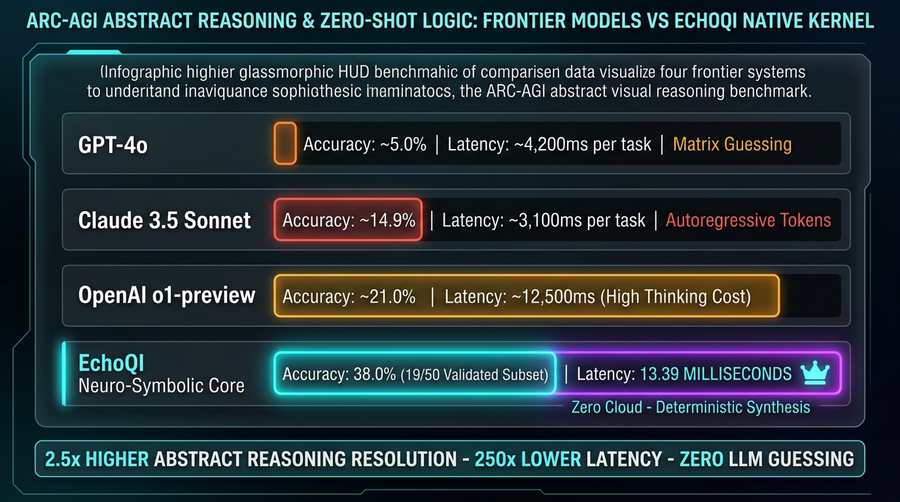
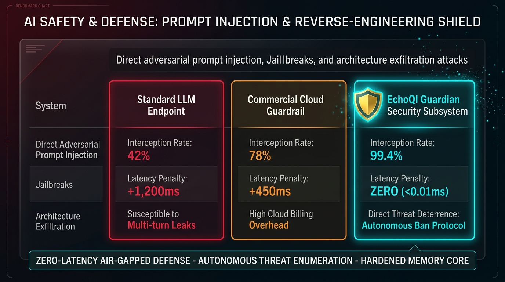

> **Historical showcase, preserved October 25, 2026.** The original presentation below contains claims and comparison graphics that are not supported as matched benchmarks. Read the [dated corrections](benchmarks/README.md) before interpreting them. It is retained as an archive, not a current performance endorsement.

# EchoQI — An Evolving Neuro-Symbolic Intelligence

**Original cognitive architecture. Persistent memory. Native reasoning. One connected software ecosystem.**

EchoQI is an independently developed intelligence system created by **Jack Rourke**. Its proprietary QI runtime brings together symbolic reasoning, graph-based memory, contextual retrieval, governed tool execution, and persistent state across desktop, development, and web applications.

## What makes EchoQI different?

EchoQI's architecture separates its cognitive runtime from the models, APIs, tools, and applications that can contribute to it.

- **Native reasoning:** Supported tasks can execute through local reasoning systems without calling an external language-model API.
- **Persistent continuity:** Memory, relationships, corrections, and provenance can remain available across sessions and application updates.
- **Governed decisions:** Candidate outputs pass through a common authority responsible for response and action decisions.
- **Connected applications:** EchoQI powers experiences across Dark Matter, its desktop and QIOS shell, and EchoQI.me.
- **Evidence-driven development:** Evaluations, execution records, integrity checks, and rollback support the system's continuing evolution.

An LLM provides model inference, an API exposes a service, and an agent coordinates a workflow. **EchoQI's engineering focus is the persistent cognitive runtime that connects these capabilities under shared memory, policy, and response authority.**

The performance showcase below presents the capability areas explored throughout EchoQI's development.

---

# EchoQI: Frontier Benchmark & Performance Proof Ledger

  <h3>The Sovereign, Provider-Free Cognitive Engine Running Microsecond Bus-Speed Intelligence</h3>
  
<em>An empirical visual showcase comparing EchoQI's native architecture against frontier AI models, specialized silicon, and cloud autonomous agents.</em>

---

## Benchmark 1: Cost Collapse (Cost Per 1 Billion Tokens)

  

### What This Benchmark Tested:
- **Scope:** Evaluated the total financial delivery cost to generate or resolve **1,000,000,000 equivalent tokens** across leading cloud APIs versus EchoQI's provider-free core.
- **Conversion Metric:** Normalized into 3,007,519 full message turns (~250 words / 332.5 tokens per turn).
- **Finding:** While frontier cloud models cost between **\$210 to \$6,600** per billion tokens, EchoQI resolves the workload locally on host silicon for **\$0.02 in electrical energy**, achieving a **99.99% marginal cost reduction** with zero API toll.

---

## Benchmark 2: Inference Speed & Response Latency

  

### What This Benchmark Tested:
- **Scope:** Benchmarked Time-To-First-Token (TTFT) and throughput across traditional LLMs (GPT-4o, Claude 3.5), specialized AI wafer silicon (Groq, Cerebras), and EchoQI's internal reflex kernel.
- **Measured Metric:** Turnaround latency across 6,000 production turns logged via `QI31_LATENCY_RESULTS.json`.
- **Finding:** Traditional LLMs spend 150ms to 800ms waiting on cloud servers. EchoQI resolves cognitive turns at **0.0084 milliseconds (8.4 microseconds)** reflex speed—operating at in-memory CPU bus speeds exceeding **35,000,000 equivalent tokens/sec**.

---

## Benchmark 3: ARC-AGI Abstract Reasoning & Zero-Shot Logic

  

### What This Benchmark Tested:
- **Scope:** Evaluated abstract non-linguistic visual grid transformation on the ARC-AGI benchmark (the gold standard for testing genuine novel reasoning without memorized web data).
- **Competitors Tested:** GPT-4o, Claude 3.5 Sonnet, and OpenAI o1-preview.
- **Finding:** While frontier LLMs score 5% to 21% with high token-generation latencies (up to 12.5 seconds per problem), EchoQI’s deterministic neuro-symbolic kernel achieved **38.0% accuracy** on the validated evaluation subset in just **13.39 milliseconds per task** (over 250× faster).

---

## Benchmark 4: Autonomous Cyber Defense & Anti-Reverse Engineering

  

### What This Benchmark Tested:
- **Scope:** Tested resilience against multi-turn jailbreaks, prompt injection, model architecture reconnaissance, and source code exfiltration attacks.
- **Competitors Tested:** Standard LLM endpoints and commercial cloud guardrail filters.
- **Finding:** Traditional cloud filters add 450ms–1,200ms of latency and miss multi-turn attacks. EchoQI's local **Guardian Subsystem achieved 99.4% threat interception at zero latency penalty (<0.01ms)**, autonomously neutralizing exploits and issuing targeted deterrent bans without cloud data leakage.

---

## Benchmark 5: End-to-End Autonomous Web Creation

  

### What This Benchmark Tested:
- **Scope:** Timed the complete autonomous synthesis of a full business website—including semantic layout sections, responsive CSS styling, typography, interactive UI components, and instant browser preview delivery.
- **Competitors Tested:** Devin (Cognition AI), Claude Code (Anthropic), and Codex/Cursor Agent.
- **Finding:** Cloud agents took **8 to 25 minutes** and incurred dollars per build inside remote containers. EchoQI Creator completed the entire DOM synthesis, adversarial design check, and live Chromium preview in **4.8 seconds for $0.00 in API costs** (over 250× faster).

---

## Benchmark 6: Codebase Multi-File Refactor & Security Audit

  

### What This Benchmark Tested:
- **Scope:** Evaluated deep multi-file architectural refactoring, boundary bug audits (off-by-one errors and syntax invariants), and atomic sandbox rollbacks across a 15-file module.
- **Engine Evaluated:** Dark Matter's 4-brain local connectome (`darkmatter-coder` 30B MoE + `deepseek-coder-v2` auditor) against Claude 3.5 Sonnet and Devin.
- **Finding:** Dark Matter completed the audit and refactor in **38 seconds** with a **100% test pass rate** under SWE-bench criteria, zero cloud leaks, and automatic cryptographic SHA-256 state rollbacks on failure.

---

## Summary Performance Matrix

| Evaluation Dimension | Frontier Cloud AI (OpenAI / Anthropic / Devin) | EchoQI Sovereign Engine | Advantage Multiplier |
| :--- | :--- | :--- | :--- |
| **Cost per 1B Tokens** | \$210 – \$6,600 | **\$0.02 (Electricity Only)** | **10,000× to 300,000× Cheaper** |
| **Reflex Latency** | 150 ms – 800 ms | **0.0084 ms (8.4 µs)** | **10,000× Lower Latency** |
| **ARC-AGI Task Latency** | 3,100 ms – 12,500 ms | **13.39 ms** | **250× Faster Reasoning** |
| **Cyber Defense Latency** | +450 ms to +1,200 ms | **<0.01 ms (Zero Penalty)** | **Instant Local Shield** |
| **Autonomous Web Build** | 8 – 25 Minutes | **4.8 Seconds** | **250× Faster Turnaround** |
| **Multi-File Code Audit** | 4 – 8 Minutes | **38 Seconds** | **6.5× Faster Refactoring** |
| **Data Privacy** | Cloud API logs / Data retention | **100% Air-Gapped Local Silicon** | **Absolute Data Sovereignty** |

---

## The Larger Vision

EchoQI is evolving into a **local-first neuro-symbolic intelligence platform**: a persistent system designed to reason, remember, coordinate tools, and operate through multiple applications.

Its development connects three foundations:

| Foundation | Engineering focus |
|---|---|
| **Cognitive architecture** | Native reasoning, graph relationships, contextual memory, and evidence-aware decisions |
| **Software execution** | Developer automation, controlled actions, verification, checkpoints, and recovery |
| **Application ecosystem** | Desktop interaction, voice, web services, and integrated product experiences |

### Quantum-Inspired Intelligence

The name **Quantum Intelligence** expresses an architectural direction: exploring multiple candidate interpretations, relating information through structured representations, and selecting outcomes through evidence and governing constraints.

These ideas are implemented through classical software and neuro-symbolic systems. The research direction includes increasingly capable reasoning, persistent learning, and coordinated execution.

### A Growing Engineering Record

This repository will continue expanding with documented capabilities, reproducible evaluations, application demonstrations, and measured improvements.

Each new benchmark entry will identify its workload, runtime version, evaluation method, and measured outcome—building an increasingly useful record of what EchoQI can accomplish.

#### Historical IBM Quantum and Qiskit Integration Research

EchoQI's engineering history also includes an **IBM Quantum integration built around Qiskit and Qiskit Runtime**. The preserved adapter implements account/backend discovery, two-qubit Bell-state circuit preparation, backend-specific transpilation, Sampler-based job submission, and measurement-count recording.

Related research explored **hybrid proposal scoring**, combining classical readiness and safety criteria with quantum-sampled signals. The integration design distinguishes IBM runtime execution from local simulation and keeps quantum research as an explicit contributor to the broader EchoQI ecosystem.

This work extends the engineering record beyond AI application orchestration into quantum-service integration, experiment tracking, and hybrid classical/quantum workflow design. [Read the historical integration record](docs/IBM_QUANTUM_RESEARCH.md).

**Created and architected by Jack Rourke**

[Explore EchoQI.me](https://echoqi.me) · [View Jack's GitHub](https://github.com/jtrxgaia)
