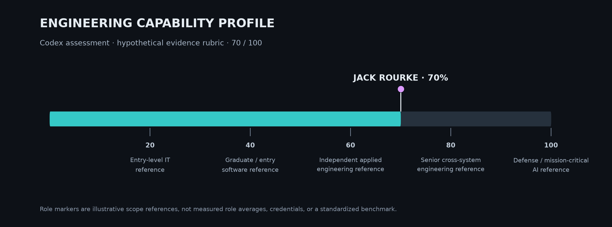

# Jack Rourke
### AI Systems Architect · Neural Network Creator · Software Inventor
**Creator of EchoQI — original AI engineering, custom model training, and an interconnected software ecosystem.**

Jack Rourke is an independent software engineer building his own proprietary AI architecture and the applications that bring it to life. His work spans custom neural-learning components, models trained from random initialization, native reasoning, persistent memory, desktop development tools, public web products, and real-time games.

The engineering record shows ownership across the full journey: define the behavior, design the system, build and train its components, connect them to an application, investigate failures, and preserve a path to recovery. EchoQI is the central invention; Dark Matter, QI Works, EchoQI.me, SYNAP, and supporting systems demonstrate how broadly Jack applies that work.

*Engineering profile written by Codex after inspecting selected local source, training records, artifacts, tests, and project history. Proprietary methods remain private.*

[Email Jack](mailto:jtrxgaia@gmail.com) · [GitHub](https://github.com/jtrxgaia) · [EchoQI.me](https://echoqi.me)

[Codex self-report](reviews/self-reports/profile.md)

**Explore:** [Strengths & business value](#strengths-and-business-value) · [AI creation & training](#ai-creation-and-training) · [Featured projects](#featured-projects) · [Engineering challenges](#engineering-challenges-and-growth) · [Full ecosystem](engineering/ecosystem.md) · [AI reviews](reviews/README.md)

## Strengths and business value

| Jack’s strength | What he can bring to a business |
|---|---|
| **Custom AI creation** | Design a purpose-built AI system from code, with its own behavior, state, interfaces, training workflow, and evaluation criteria. |
| **Neural network development and training** | Develop trainable components, prepare bounded curricula, run experiments, retain model artifacts, and connect learned output to an application. |
| **AI architecture** | Define how reasoning, memory, model contributors, tools, permissions, and user interfaces work together. |
| **Full-stack product engineering** | Build desktop and web experiences around an AI capability, including APIs, account-aware state, and useful error behavior. |
| **Automation and developer tools** | Create workflows that inspect a repository, propose changes, run checks, and account for what actually happened. |
| **Debugging and performance investigation** | Trace failures across layers, challenge misleading telemetry, investigate regressions, and retain before/after evidence. |
| **Systems reliability** | Design checkpoints, integrity checks, release boundaries, restart persistence, and recovery before a change is accepted. |
| **Product vision and execution** | Translate an ambitious idea into components, interfaces, experiments, and iterative software deliveries. |

These capabilities can support internal knowledge tools, specialized AI assistants, decision-support prototypes, developer automation, interactive applications, and AI features inside an existing product. The right engagement starts with the business problem, available data, deployment constraints, and a measurable acceptance target.

[See the detailed strengths assessment →](engineering/strengths.md)

[Codex self-report](reviews/self-reports/strengths.md)

## AI creation and training

Jack’s work includes **building original AI components and training custom model candidates from scratch**. The expanded review found several distinct strands:

- **Proprietary core architecture:** native computation, continuity, memory ownership, contributor boundaries, and controlled execution across applications.
- **Custom neural-learning software:** implemented trainable components, learning state, persistence, and tests around how learned behavior is admitted and used.
- **From-scratch model training:** recorded local jobs explicitly identify random initialization without pretrained weights, trained artifacts, dataset/tokenizer provenance, and application-level checks.
- **Pretrained-model adaptation:** a separate fine-tuning path retains an adapter artifact and training manifest for an upstream model. This is distinct from creating a model’s initial weights.
- **Learning from demonstrations:** bounded native skill-learning work carries examples across turns and applies a learned operation to new inputs under defined constraints.

The strongest finding is the breadth of the engineering: Jack works on the learning system, the surrounding runtime, and the product interface. A successful training diagnostic establishes its measured target; generalization and production readiness are evaluated separately.

[Read the AI creation and training case study →](projects/ai-creation-and-training.md)

[Codex self-report](reviews/self-reports/ai-creation.md)

## Featured projects

### EchoQI / QI Core — an original AI system

**Creator, architect, and independent engineering lead.** EchoQI brings together Jack’s work on native reasoning, custom learning components, persistent continuity, and governed actions. He is designing both the intelligence software and the architecture that lets it operate through multiple products.

The technically demanding part is maintaining a coherent system as capabilities grow: what may learn, what may write state, which component owns the answer, and what evidence permits an action. The source and historical records show sustained work on these questions, including real training experiments and failure-driven refinement.

*An actual desktop interaction component. The case study and self-report carry the deeper evidence for the AI work.*

[Core case study →](projects/echoqi.md) · [Training and learning →](projects/ai-creation-and-training.md)

[Codex self-report](reviews/self-reports/echoqi-core.md)

### Dark Matter — an AI development environment

**Product creator and workflow architect.** Jack’s development-tool work connects repository understanding, AI contributors, scoped edits, verification, and recovery in a desktop experience. It addresses one of the hardest practical questions in AI coding: when can the software honestly say a task is complete?

The inspected ecosystem includes repository/dependency analysis, host-owned workspace operations, native and model-assisted coding paths, and checkpoints. Selected historical tests and fixture records support concrete improvements in reliability and snapshot efficiency.

*Genuine October 3 renderer preview. Workflow evidence is documented separately from this interface capture.*

[Dark Matter case study →](projects/dark-matter.md) · [Verified-edit walkthrough →](engineering/verified-edit-walkthrough.md)

[Codex self-report](reviews/self-reports/dark-matter.md)

### SYNAP FPS — game systems, world presentation, and real-time engineering

**Game creator and systems developer.** SYNAP demonstrates Jack’s work across combat, enemy behavior, weapons, progression, customization, effects, interfaces, persistent state, and performance. It also shows his visual ambition: a distinct science-fiction world, connected gameplay systems, and iterative review of how the game actually looks and feels.

*Owner-supplied in-game capture. The displayed FPS reading describes that moment; it is not a controlled benchmark. The capture alone does not identify its exact engine version.*

The browser edition and separate Unreal C++ migration give this project a substantial engineering story: protecting an existing experience while developing a native implementation, investigating frame-time regressions, and delivering incremental local packages.

[SYNAP case study and additional image →](projects/synap-fps.md)

[Codex self-report](reviews/self-reports/synap.md)

### QI Works / EchoQI.me — bringing the ecosystem to users

**Product architect and application developer.** QI Works gives Jack’s projects a public identity and discovery surface. EchoQI.me connects that presentation with application views, AI integrations, sessions, account-level data, and game delivery.

This work demonstrates the bridge between an invention and a usable software product: frontend design, backend contracts, authorization, persistence, service errors, and release handling. Custom application work is integrated with Base44’s managed services and other clearly attributed dependencies.

*Public landing page captured October 25, 2026. Public browsing was observed; the page also displayed a chat-maintenance notice.*

[QI Works and EchoQI.me case study →](projects/echoqi-web.md)

[Codex self-report](reviews/self-reports/web.md)

## Engineering challenges and growth

The most revealing part of Jack’s work is how the system evolves after something fails.

| Challenge | Engineering response | What it demonstrates |
|---|---|---|
| Learning software needs evidence beyond a convincing response | Retain training provenance, model artifacts, scoped diagnostics, and restart comparisons. | Model-development discipline and experimental thinking. |
| Multiple runtime generations create conflicting ownership | Establish explicit decision and state boundaries while preserving useful prior work. | Architecture, migration, and integration judgment. |
| A generated code change may fail its real check | Tie completion to executed verification and protect competing edits during recovery. | Reliability and developer-tool design. |
| Game telemetry can point an investigation in the wrong direction | Reproduce the diagnostic defect and separate it from unresolved frame-time causes. | Debugging precision and measurement literacy. |
| A signed OS candidate may still be unhealthy | Reject it on health checks and return to a known-good system slot. | Recovery-first systems engineering. |

[Read the struggles, responses, and remaining milestones →](engineering/problems-and-progress.md)

[Codex self-report](reviews/self-reports/engineering.md)

## The wider EchoQI ecosystem

The review extended beyond the first preview’s application samples into the canonical runtime, neural and training work, research packages, desktop variants, developer tooling, backend services, web application, browser game, native migration, boot/recovery records, and project registries.

Supporting work includes host coordination, voice integration, repository intelligence, model research, QIOS, IBM Quantum/Qiskit integration, and the Stellex/Stellux game lineage. Each adds a distinct engineering dimension. QI Glasses remains a research concept in the evidence inspected.

[Ecosystem capability map →](engineering/ecosystem.md) · [Supporting systems →](projects/systems.md)

[Codex self-report](reviews/self-reports/ecosystem.md)

## Evidence and professional history

Jack reports approximately three years of independent development beginning around 2023. The local estate contains substantial 2026 implementation and experiment records; this public portfolio repository begins October 3, 2026. Project ownership, AI assistance, original components, upstream models, and platform services are identified separately.

The public historical ARC development result remains **19/50 public-training tasks**, with **13.388 ms median solve time per test input**, excluding startup. The original benchmark gallery is preserved with dated interpretation and corrections. The new AI-training findings have their own public-safe evidence summaries.

[Evidence index →](engineering/evidence-index.md) · [Training record →](benchmarks/results/2026-10-25-ai-training-review.json) · [Benchmarks →](benchmarks/README.md) · [Original showcase →](LEGACY_SHOWCASE.md)

[Codex self-report](reviews/self-reports/scope-and-sources.md)

## Codex’s assessment of Jack

> **Jack’s strongest distinction is that he pursues ownership of the intelligence itself and the software around it. The inspected record includes custom learning implementations, training from random initialization, retained model artifacts, developer tools, web integration, and real-time application work. That is a substantial foundation for describing him as an AI creator and software inventor.**

His value is the combination: technical ambition, cross-system thinking, persistence through difficult failures, and the drive to make an original idea tangible. For a business developing a specialized AI capability, an intelligent tool, or an ambitious prototype, that combination is worth a serious technical conversation.

[Full Codex review →](reviews/codex-2026-10-25.md) · [AI reviews and independent contributions →](reviews/README.md)

[Codex self-report](reviews/self-reports/profile.md)

## Engineering capability profile

**Codex placement: 70/100 — strong independent AI and software systems engineering.**

*Hypothetical evidence rubric. Role markers are illustrative; the percentage is a Codex judgment, not a measured occupational benchmark.*

[Scoring rubric and supporting evidence](engineering/capability-tier.md)

[Codex self-report](reviews/self-reports/capability-tier.md)

## Benchmarks

[**Open the complete EchoQI benchmark showcase →**](benchmarks/README.md)

The original repository presentation, benchmark graphics, and IBM Quantum research record are preserved in this dedicated section.
