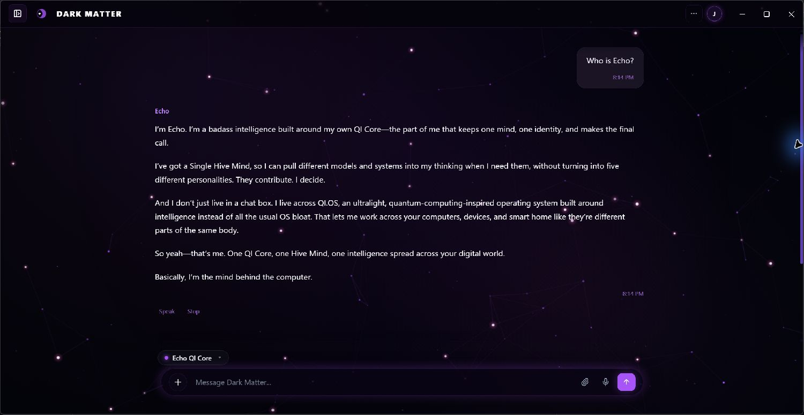
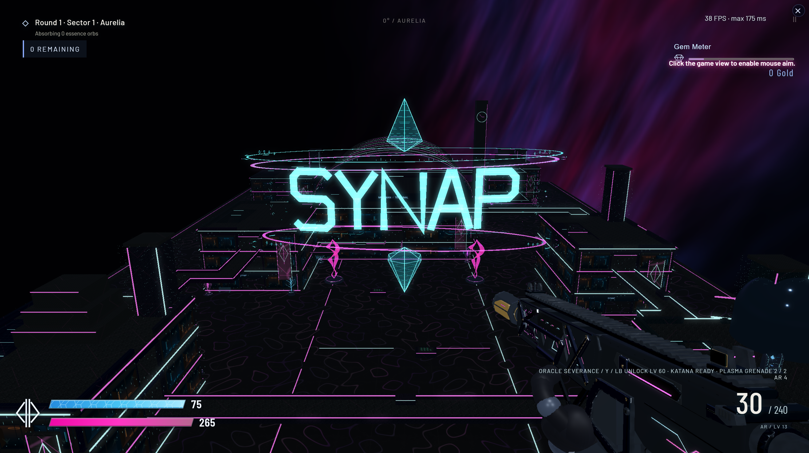

# Jack Rourke
### AI Systems Architect · Software Engineer

Jack Rourke is an independent AI systems architect and the creator of EchoQI. He designs how AI components, memory, tools, and applications fit together, then directs and verifies their construction across desktop software, web applications, developer tools, and games.

At the center is QI Core, the proprietary system behind EchoQI. Around it are projects that explore how AI can be used in everyday software: Dark Matter for development, QI Works and EchoQI.me for web-based tools, and SYNAP FPS for real-time gameplay.

[Contact](mailto:jtrxgaia@gmail.com) · [GitHub](https://github.com/jtrxgaia) · [EchoQI.me](https://echoqi.me)

**Explore:** [Skills](#engineering-specializations) · [AI development](#ai-development) · [Projects](#projects) · [Problem solving](#engineering-investigations) · [Code](#code-samples) · [History](#development-history) · [Reviews](#technical-reviews) · [Repository directory](#repository-directory)

### At a glance

| | |
|---|---|
| **Role** | Architect and product owner: system design, AI direction, verification, and delivery |
| **Flagship** | EchoQI / QI Core: a proprietary neuro-symbolic AI system with persistent memory and multi-model coordination |
| **Shipped surfaces** | Dark Matter (desktop AI coding platform), QI Works / EchoQI.me (web), SYNAP FPS (browser and Unreal Engine) |
| **Public code** | [Three tested samples](code/README.md) covering evidence integrity, verified AI edits, and fair benchmark scoring |
| **Evidence standard** | Every benchmark is published with its method, its limits, and any later correction |

## Engineering specializations

| Area | Examples of the work |
|---|---|
| AI architecture | Connecting reasoning, memory, models, and tools within one system. |
| Neural networks and training | Writing trainable components, running experiments, saving trained models, and checking their behavior. |
| Desktop and web development | Building interfaces, backend services, user accounts, and AI integrations. |
| Developer tools | Understanding codebases, applying changes, running checks, and recovering from failed edits. |
| Game development | Weapons, characters, enemies, maps, progression, rendering, and saved games. |
| Debugging and reliability | Reproducing failures, correcting misleading measurements, and restoring working versions. |

These skills apply to specialized AI assistants, internal business tools, development automation, and interactive software.

[Skills and practical applications](benchmarks/portfolio/engineering/strengths.md) · [Development workflow](benchmarks/portfolio/engineering/workflow.md)

## AI development

The AI work includes both building original components and training them. Some experiments start with randomly initialized weights; others adapt an existing model. These are separate approaches, and the records identify which one was used.

Other work explores learning from examples, saving what has been learned, and connecting the result to an application. The surrounding software handles memory, access to tools, and decisions about which component may change the system.

An October 25 experiment met its training target on 34 examples and produced consistent results across eight checked outputs after a restart. Those examples were used during training, so the result shows that the model learned the training material. Testing on unseen examples is a separate step.

[AI development case study](benchmarks/portfolio/projects/ai-creation-and-training.md) · [Training record](benchmarks/results/2026-10-25-ai-training-review.json)

## Projects

### EchoQI / QI Core

EchoQI is a proprietary AI system designed by Jack Rourke. It combines custom learning software, reasoning, persistent memory, and tools that connect it to desktop and web applications.

The broader design is described as a **neuro-symbolic, quantum-inspired hybrid HiveMind**. The QI Core is designed to coordinate several compatible LLMs at the same time on a shared problem or software build. The design has developed over several years, with a history dating to around 2023 according to the developer’s records.

#### How the parts work together

“Neuro-symbolic” describes the combination of learned behavior and explicit reasoning. Trainable components learn from examples. Other parts handle supported operations, relationships, rules, and constraints. The architecture defines where each belongs and how its output can be used.

Compatible external models contribute through defined interfaces. In HiveMind, the core coordinates concurrent contributions toward the same task. These models remain separate from the original core and its custom learning components.

#### Memory that carries across interactions

Memory work focuses on keeping useful context, relationships, and corrections between interactions. It also addresses a less visible problem: deciding which part of the software can change that information and how to recover if a change goes wrong.

Saved state, integrity checks, and restart tests help check that information survives as intended. Each test establishes a specific behavior; it does not prove that every kind of memory works in every situation.

#### HiveMind: several models, one shared task

HiveMind is the design in which the neuro-symbolic QI Core uses **Gemini, GPT, Claude, Kimi, and other compatible LLMs concurrently** to work on the same problem. That problem might be a research question, a software build, or the development of a larger system.

The core coordinates the work around a shared objective and brings the models’ contributions into the same workflow. The defining feature is their simultaneous participation in a common task, with the QI Core providing the coordination.

Available compute, provider access, and task requirements determine how much work can run in parallel. The creator uses **“super AI”** to describe the combined capability envisioned when sufficient compute is available. This is a description of the design’s ambition; performance gains need to be established through task-specific comparisons.

[HiveMind design and scope](benchmarks/portfolio/projects/echoqi.md#hivemind)

#### Building and training the learning components

The development record includes custom trainable code, learning from demonstrations, training without pretrained weights, and adaptation of an existing model. Training records identify the data and tokenizer used, saved model files, results, and restart checks.

Learning, retrieving stored information, and following a demonstrated operation are treated as different functions. The [training record](benchmarks/results/2026-10-25-ai-training-review.json) explains what the completed experiments tested and what remains untested.

#### Quantum research

The quantum-inspired design and the IBM Quantum/Qiskit research are separate parts of the project. The documented reasoning system runs on classical software. The quantum research explores connections to external quantum services, with simulation and classical alternatives recorded separately.

This is integration and research work. The available records do not demonstrate quantum advantage or establish that EchoQI’s reasoning runs on quantum hardware. [Quantum integration record](benchmarks/portfolio/docs/IBM_QUANTUM_RESEARCH.md).

#### Turning the core into usable software

The work extends to the interfaces, services, permissions, diagnostics, and recovery tools needed to use the core in an application. That includes deciding how requests reach the system, how results return to the user, and what happens when an operation fails.

The public record explains these responsibilities and results. The core’s implementation, training recipes, private data, and model files remain private.

*An Echo desktop interface component.*

[Core case study](benchmarks/portfolio/projects/echoqi.md) · [Source inspection record](benchmarks/results/2026-10-25-expanded-inspection.json) · [Codex core review](benchmarks/portfolio/reviews/self-reports/echoqi-core.md)

### Dark Matter

Dark Matter is an AI-assisted coding and creation platform for developing software and building projects, similar in purpose to Antigravity, Codex, and Claude Code.

**Built with:** Electron, React, Vite, Node.js, and local model adapters.

*Dark Matter desktop platform, October 25, 2026, after asking “Who is Echo?” The reply is shown as generated; it is not a benchmark or independent verification of its claims.*

[Dark Matter case study](benchmarks/portfolio/projects/dark-matter.md) · [How changes are checked](benchmarks/portfolio/engineering/verified-edit-walkthrough.md)

### QI Works / EchoQI.me

QI Works introduces the projects in the EchoQI ecosystem. EchoQI.me brings the broader web application together, including AI conversations, image and video workflows, user sessions, account data, and game access.

The platform connects the proprietary core with external AI and media services. Custom application code handles the interfaces and integrations, while Base44 provides managed services.

**Built with:** React, JavaScript/TypeScript, Vite, Tailwind, TanStack Query, and Base44.

**Recorded results:** 20 selected checks passed across public adapters, game-match logic, and simulated purchase/save workflows. These tests did not establish that every current signed-in feature or live transaction works.

*Public landing page, October 25, 2026. Chat was marked as under maintenance when this image was captured.*

[QI Works and EchoQI.me case study](benchmarks/portfolio/projects/echoqi-web.md)

### SYNAP FPS

SYNAP is a science-fiction first-person shooter with custom weapons, modular equipment, characters, enemy behavior, maps, progression, and saved state. Development covers both the game’s systems and how they look and feel in play.

The browser edition uses **TypeScript, Babylon.js, and Rapier**. A separate native version uses **Unreal Engine and C++**. Native development builds have been packaged, while feature parity, regression fixes, and performance testing remain in progress.

*Gameplay capture supplied for the portfolio. The FPS overlay shows that moment, not a controlled benchmark; the image does not identify an exact engine version.*

The development history includes work on rendering, asset integration, packaging, and misleading performance telemetry. The case study also explains the use of AI assistance and established engines.

[SYNAP case study and more images](benchmarks/portfolio/projects/synap-fps.md)

## Engineering investigations

Some of the most useful project records concern things that went wrong:

- **AI learning:** keeping training results separate from performance on unseen examples.
- **Runtime integration:** resolving which component controls a decision or changes shared state.
- **Generated code:** requiring executed checks and protecting edits made outside the current task.
- **Game performance:** reproducing a diagnostic that displayed a mesh count as milliseconds, then separating that reporting error from unresolved frame-time problems.
- **OS updates:** rejecting an unhealthy signed update and restoring a known-good version.

[Investigations, fixes, and open work](benchmarks/portfolio/engineering/problems-and-progress.md)

## Code samples

QI Core stays private. To show how Jack approaches engineering, this repository includes three small programs written for publication. Each has automated tests that run on every change:

- **[Evidence verifier](code/evidence-verifier/verify.mjs):** confirms every published file still matches its recorded fingerprint.
- **[Verified edit](code/verified-edit/verified-edit.mjs):** accepts an AI-generated change only after a real check passes, and rolls back failures without overwriting someone else’s work.
- **[ARC scoring harness](code/arc-harness/harness.mjs):** hides the answers from the solver, requires exact matches, and compares against a do-nothing baseline.

[About the code samples](code/README.md)

## Related systems

Other projects explore voice interfaces, communication between hosts, codebase analysis, model research, QIOS, quantum-service integration, and the Stellex/Stellux games. QI Glasses remains a research concept; the reviewed material does not establish a physical prototype.

[Ecosystem map](benchmarks/portfolio/engineering/ecosystem.md) · [Supporting systems](benchmarks/portfolio/projects/systems.md)

## Development history

The developer’s history places the start of independent work around 2023. The linked evidence includes implementation, training, and delivery records from 2026. This repository’s public history begins October 3, 2026, so it cannot verify the full earlier timeline on its own.

One historical ARC development run passed **19 of 50 public-training tasks**, with a **13.388 ms median solve time per test input**, excluding startup. This was a development result on public training tasks, not a hidden-test score. Older comparison charts are preserved alongside corrections and explanations of their limits.

[Evidence index](benchmarks/portfolio/engineering/evidence-index.md) · [Results and methods](benchmarks/METHODS.md)

## Technical reviews

The linked AI-authored reviews discuss the source, test results, and project records examined. Each names its author and scope. They are assessments of the evidence, not independent certifications.

[Codex review — GPT 6.1 Sol](benchmarks/portfolio/reviews/codex-2026-10-25.md) · [Project reviews](benchmarks/portfolio/reviews/README.md)

## Engineering capability profile

The projects span AI development, desktop and web software, developer tools, and games. The supporting records explain what has been built, what has been tested, and what still needs work.

[Capabilities and supporting evidence](benchmarks/portfolio/engineering/capabilities.md)

## Benchmarks

The earlier front page, benchmark charts, and IBM Quantum research record are preserved here. Read the methods and corrections alongside the historical comparisons.

[Benchmark showcase](benchmarks/README.md) · [Methods and corrections](benchmarks/METHODS.md) · [Original repository snapshot](benchmarks/original-repository/README.md)

## Repository directory

| Material | Location |
|---|---|
| Code samples and tests | [code](code/README.md) |
| Benchmarks and historical showcase | [benchmarks](benchmarks/README.md) |
| Technical documentation | [docs](benchmarks/portfolio/docs/) |
| Engineering records | [engineering](benchmarks/portfolio/engineering/) |
| Images and media | [media](benchmarks/portfolio/media/) |
| Project case studies | [projects](benchmarks/portfolio/projects/) |
| Evidence receipts | [receipts](benchmarks/portfolio/receipts/) |
| Historical reports | [reports](benchmarks/portfolio/reports/) |
| Research records | [research](benchmarks/portfolio/research/) |
| Attributed technical reviews | [reviews](benchmarks/portfolio/reviews/README.md) |
| Original benchmark audit | [October 3 audit](benchmarks/portfolio/2026-10-03_EchoQI_Benchmark_Audit_v1.md) |
| Change history | [Changelog](benchmarks/portfolio/CHANGELOG.md) · [History](benchmarks/portfolio/HISTORY.md) |
| Publication policy | [Evidence policy](benchmarks/portfolio/EVIDENCE_POLICY.md) |
| Previous front page | [Legacy showcase](benchmarks/portfolio/LEGACY_SHOWCASE.md) |
| File integrity record | [Publication manifest](benchmarks/portfolio/PUBLICATION_MANIFEST.json) |
