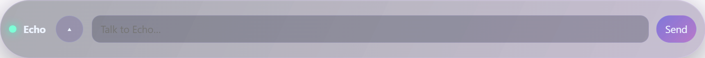
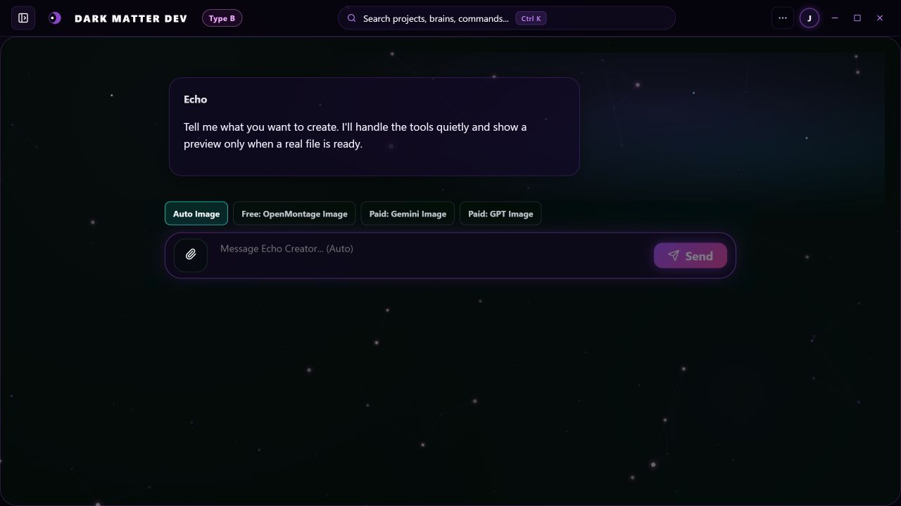

# Jack Rourke
### AI Systems Architect · Software Engineer

Jack Rourke is an independent software engineer and the creator of EchoQI, a proprietary AI system. Areas of work include custom neural-learning components, model training, persistent memory, developer tools, web applications, and real-time games.

The EchoQI ecosystem includes the QI Core runtime, Dark Matter development tools, QI Works, EchoQI.me, and SYNAP FPS. Development responsibilities span architecture, AI-assisted implementation, training experiments, application integration, testing, and release workflows.

[Contact](mailto:jtrxgaia@gmail.com) · [GitHub](https://github.com/jtrxgaia) · [EchoQI.me](https://echoqi.me)

**Contents:** [Engineering specializations](#engineering-specializations) · [AI development](#ai-development) · [Projects](#projects) · [Engineering investigations](#engineering-investigations) · [Development history](#development-history) · [Technical reviews](#technical-reviews) · [Repository directory](#repository-directory)

## Engineering specializations

| Area | Work represented in the ecosystem |
|---|---|
| Custom AI architecture | Reasoning components, persistent state, model contributors, tool interfaces, and controlled execution. |
| Neural-network development | Custom trainable components, model initialization, training workflows, retained artifacts, and evaluation. |
| Desktop and web applications | Electron and React interfaces, backend services, account-aware state, and AI integrations. |
| Developer tools | Repository analysis, scoped edits, executed verification, checkpoints, and recovery. |
| Real-time software | Gameplay, weapons, enemy behavior, progression, rendering, persistence, and engine migration. |
| Reliability and diagnostics | Failure isolation, telemetry correction, regression investigation, integrity checks, and rollback. |

Applications include specialized assistants, internal knowledge tools, developer automation, and interactive software. Deployment requirements and acceptance criteria vary by application.

[Engineering specializations and applications](engineering/strengths.md) · [Development workflow](engineering/workflow.md)

## AI development

EchoQI development includes original AI components and custom model-training experiments:

- **Core architecture:** native computation, persistent continuity, state ownership, contributor interfaces, and controlled execution.
- **Neural-learning software:** trainable components, saved learning state, and tests governing the use of learned behavior.
- **From-scratch training:** recorded jobs initialized without pretrained weights, with dataset/tokenizer provenance and retained artifacts.
- **Model adaptation:** a separate fine-tuning path using an upstream model, a training manifest, and a saved adapter.
- **Learning from demonstrations:** bounded skill-learning work using examples across turns.

The October 25 training record documents a 34-example training-fit diagnostic and an eight-output restart comparison using the same weights. These establish the reported fitting and persistence results; independent generalization remains a separate evaluation stage.

[AI development case study](projects/ai-creation-and-training.md) · [Training record](benchmarks/results/2026-10-25-ai-training-review.json)

## Projects

### EchoQI / QI Core

EchoQI is a proprietary neuro-symbolic AI system designed by Jack Rourke. Its development combines custom learning software, native reasoning, persistent memory, and coordination across desktop, web, and developer-tool applications. The developer describes the broader design as a **neuro-symbolic, quantum-inspired hybrid “hive mind”**: a connected system in which specialized components contribute to a shared runtime and persistent system identity.

The project forms part of a development history beginning around 2023, according to developer-provided records. The public evidence includes later implementation, training, integration, and recovery records; it does not independently date every earlier stage.

#### Neuro-symbolic architecture

The architecture combines trainable components with explicit reasoning and application rules. Neural-learning work covers parameterized behavior and retained learning state. Symbolic and native processing cover supported task operations, relationships, constraints, and controlled decisions. These components have separate responsibilities within the larger system.

This arrangement supports the integration of learned behavior with explicit state and execution boundaries. Upstream models can contribute through defined interfaces alongside original components; their involvement is recorded separately from the proprietary core.

#### Persistent memory and continuity

Memory and continuity work covers retained context, relationship-based information, corrections, state ownership, and restart behavior. The system is designed to preserve relevant state across interactions while controlling which components may modify it.

Persistence is treated as an engineering responsibility with saved state, integrity checks, and recovery records. The available training evidence also includes an eight-output restart comparison using the same weights, establishing consistency for that specific experiment.

#### Hybrid coordination and the “hive mind” concept

The “hive mind” description refers to the coordination of specialized processing components, model contributors, memory services, tools, and application interfaces. Cognition, conversation, persistent state, and execution have defined owners rather than operating as unrelated chat sessions.

Desktop interfaces, Dark Matter, and web integrations provide different application surfaces around the wider ecosystem. Host-coordination work adds capability authorization, request identity, and execution records. Integration and physical deployment retain separate acceptance requirements; a shared design does not establish that every service or host is currently qualified for operation.

#### Custom learning and training

Development includes custom trainable implementations, learning from demonstrations, training from random initialization without pretrained weights, and a separate upstream-model adaptation path. Recorded artifacts include training manifests, dataset/tokenizer provenance, saved model identities, fitting diagnostics, and restart comparisons.

The October 25 experiment met its defined fitting target on 34 training-exposed examples across two task types. This documents a bounded training experiment, with independent generalization and product readiness assessed separately. Neural training, demonstration learning, and retrieval remain distinct functions within the architecture.

#### Quantum-inspired design and quantum-service research

The project’s quantum-inspired design language is distinct from its IBM Quantum/Qiskit integration research. The documented cognitive runtime uses classical graph and reasoning software. Separate research materials describe interfaces for experimental contributions from external quantum services, with simulation and classical fallback paths identified separately.

The preserved records establish integration work and research intent. They do not establish quantum advantage or demonstrate that the cognitive runtime operates on quantum hardware. [Quantum integration record](docs/IBM_QUANTUM_RESEARCH.md).

#### Core engineering and application integration

Development responsibility covers the core’s architecture and custom components together with the software needed to expose them through applications: service contracts, user interfaces, authorized actions, diagnostics, checkpoints, and recovery. This connects model and reasoning experiments to persistent software products.

Public documentation describes component responsibilities and measured outcomes. Proprietary representations, internal procedures, training recipes, model payloads, and private state are excluded.

*Desktop interaction component associated with the ecosystem.*

[Core case study](projects/echoqi.md) · [Training evidence](benchmarks/results/2026-10-25-ai-training-review.json) · [Implementation inspection record](benchmarks/results/2026-10-25-expanded-inspection.json) · [Attributed core review](reviews/self-reports/echoqi-core.md)

### Dark Matter

Dark Matter is a desktop development environment connecting repository analysis, AI coding contributors, workspace operations, verification, and recovery.

**Technologies:** Electron, React, Vite, Node.js, and local model adapters.  
**Recorded results:** 29 selected checks passed and one was skipped. The largest snapshot fixture reduced file reads from 1,000 to 500 while preserving baseline hashes. These are historical, workload-specific results.

The workflow distinguishes proposed changes from executed operations and ties completion to required checks. Checkpoints and content-ownership checks support recovery without overwriting competing edits.

*Creator renderer preview, October 3, 2026; workflow results are documented separately.*

[Dark Matter case study](projects/dark-matter.md) · [Verification workflow](engineering/verified-edit-walkthrough.md)

### SYNAP FPS

SYNAP FPS is a science-fiction game project covering weapons, modular equipment, characters, enemy behavior, progression, maps, rendering, interfaces, and saved state. Development includes a browser edition and a separate native implementation.

**Technologies:** TypeScript, Babylon.js, and Rapier; Unreal Engine and C++ for the native project.  
**Delivery status:** browser edition and packaged native development builds. Native parity, regression closure, and performance acceptance remain in progress.

*Supplied gameplay capture. The FPS overlay is a momentary reading, not a controlled performance benchmark; the image does not establish an exact engine revision.*

Development records cover telemetry investigation, rendering workload, asset integration, packaging, and migration between engines. AI-assisted implementation and established engine dependencies are documented in the case study.

[SYNAP case study and additional image](projects/synap-fps.md)

### QI Works / EchoQI.me

QI Works provides product presentation and discovery for the EchoQI ecosystem. EchoQI.me includes application views, AI integrations, sessions, account-level data, and game delivery.

**Technologies:** React, JavaScript/TypeScript, Vite, Tailwind, TanStack Query, and Base44.  
**Recorded results:** 20 selected passing checks covering public adapters, match-core behavior, and simulated purchase/save workflows. Current authenticated-service readiness requires separate validation.

Application engineering covers frontend/backend contracts, authorization boundaries, persistence, service errors, and release handling. Base44 supplies managed application services alongside custom application work.

*Public landing page captured October 25, 2026. A chat-maintenance notice was visible at the time.*

[QI Works and EchoQI.me case study](projects/echoqi-web.md)

## Engineering investigations

| Area | Recorded work |
|---|---|
| Learning behavior | Training provenance, saved artifacts, scoped fitting diagnostics, and restart comparisons. |
| Runtime integration | Decision and state boundaries across multiple implementation generations. |
| Generated changes | Required verification, content identity checks, and recovery that protects competing edits. |
| Game telemetry | Reproduction of a diagnostic-units defect, separated from unresolved frame-time causes. |
| OS updates | Health-check rejection of a signed candidate and restoration of a known-good system slot. |

[Investigation records and open milestones](engineering/problems-and-progress.md)

## Related systems

Supporting projects cover host coordination, voice integration, repository intelligence, model research, QIOS, IBM Quantum/Qiskit integration, and the Stellex/Stellux game lineage. QI Glasses is documented as a research concept; the reviewed evidence does not establish a physical prototype.

[Ecosystem map](engineering/ecosystem.md) · [Supporting systems](projects/systems.md)

## Development history

Independent development began around 2023 according to the developer-provided history. The linked record includes 2026 implementation, training, and delivery artifacts. This public repository’s history begins October 3, 2026 and does not independently establish the earlier development period.

The historical ARC development record reports **19/50 public-training tasks passed**, with a **13.388 ms median solve time per test input**, excluding startup. This is a public-training development result, not a hidden-evaluation score. Historical comparison graphics are retained with methods and corrections.

[Evidence index](engineering/evidence-index.md) · [Historical results and methods](benchmarks/METHODS.md)

## Technical reviews

Separately attributed AI-authored reports discuss source inspection, historical tests, and delivery records. These reports are commentary on the cited evidence rather than independent certification.

[Codex technical review — GPT 6.1 Sol](reviews/codex-2026-10-25.md) · [Project reports and review scope](reviews/README.md)

## Engineering capability profile

The project record covers AI architecture and training, desktop/web integration, developer tools, and real-time software. Supporting records distinguish implemented components, selected validation results, and incomplete acceptance work.

[Capabilities and supporting evidence](engineering/capabilities.md)

## Benchmarks

The previous repository presentation, benchmark graphics, and IBM Quantum research record are preserved in the historical archive. Methods and dated corrections identify the scope of supported results.

[Benchmark showcase](benchmarks/README.md) · [Methods and corrections](benchmarks/METHODS.md) · [Original repository snapshot](benchmarks/original-repository/README.md)

## Repository directory

| Material | Location |
|---|---|
| Benchmarks and historical showcase | [benchmarks](benchmarks/README.md) |
| Technical documentation | [docs](docs/) |
| Engineering records | [engineering](engineering/) |
| Images and media | [media](media/) |
| Project case studies | [projects](projects/) |
| Evidence receipts | [receipts](receipts/) |
| Historical reports | [reports](reports/) |
| Research records | [research](research/) |
| Attributed technical reviews | [reviews](reviews/README.md) |
| Original benchmark audit | [October 3 audit](2026-10-03_EchoQI_Benchmark_Audit_v1.md) |
| Change history | [Changelog](CHANGELOG.md) · [History](HISTORY.md) |
| Publication policy | [Evidence policy](EVIDENCE_POLICY.md) |
| Previous front page | [Legacy showcase](LEGACY_SHOWCASE.md) |
| File integrity record | [Publication manifest](PUBLICATION_MANIFEST.json) |
