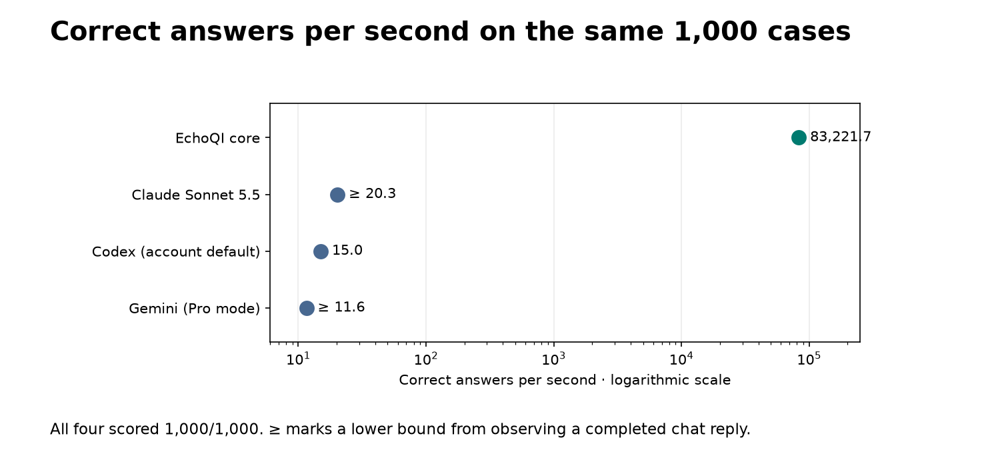
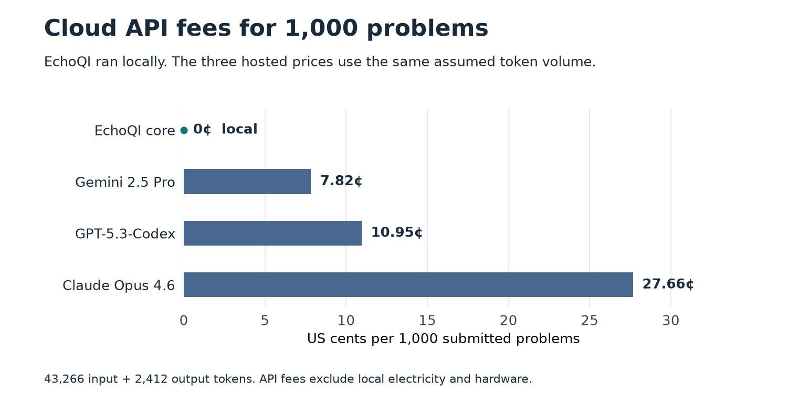

# Results and how to check them

[Portfolio](../README.md) · [Run all public checks](../code/README.md) · [Detailed methods](METHODS.md)

### EchoQI benchmark graphs

[See the graphs, pricing assumptions and test cases](local-core-2026-11-14/).

| Result | What it means | Can an outside reviewer rerun it? |
|---|---|---|
| Local symbolic skills: 1,000/1,000 cases and 5 million correct answers in 12.41 s | Direct local execution across five task families | [Inspect the cases, check answers and review CPU energy](local-core-2026-11-14/) |
| Public tests and demonstration | The published verification and scoring code passes its documented checks | **Yes:** `npm run proof` from `code` |
| Safety comparison: verified 90/90, baseline 30/90 | Nine controlled editing conditions, repeated ten times; tests preservation and completion rules | **Yes:** `npm run benchmark`. [Methods](../portfolio/engineering/public-safety-benchmark.md) · [Raw trials](results/2026-10-26-public-edit-safety.json) |
| Private component checks: 47/47 | Selected learning and persistence tests passed in a retained snapshot | **Confidential review:** [aggregate receipt](results/2026-10-26-private-component-recheck.json) |
| Synthetic learning: 200/200 learned and restored; untrained 0/200; disabled 0/200 resolved | Transfer to new values in one supported task family, with controls | **Confidential review:** same receipt; not broad generalization |
| Model training: 34/34 exposed examples and eight consistent restart outputs | Training fit and saved-model consistency | **Retained private record:** [training receipt](results/2026-10-25-ai-training-review.json); not independently held-out performance |
| Historical ARC: 19/50 public-training tasks | A dated development result, not a hidden-test score | **Not from this public code:** proprietary solver absent. [Methods and receipt](METHODS.md#arc-agi-2-development-measurement) |

The public safety benchmark tests the reference editor, not Dark Matter or AI quality. Repeated conditions are not a production success rate. Private records are AI-authored observations, not independent audits. Hashes identify files; they do not prove the underlying claims.

## Historical archive

Earlier performance charts remain available for traceability. Unsupported multipliers and comparisons are explained in [methods and corrections](METHODS.md#corrections-to-the-historical-showcase).

- [Original repository snapshot](original-repository/README.md)
- [Earlier portfolio showcase](../portfolio/LEGACY_SHOWCASE.md)
- [October 3 benchmark audit](../portfolio/2026-10-03_EchoQI_Benchmark_Audit_v1.md)

[Evidence index](../portfolio/engineering/evidence-index.md) · [Confidential verification](../portfolio/engineering/confidential-verification.md)
