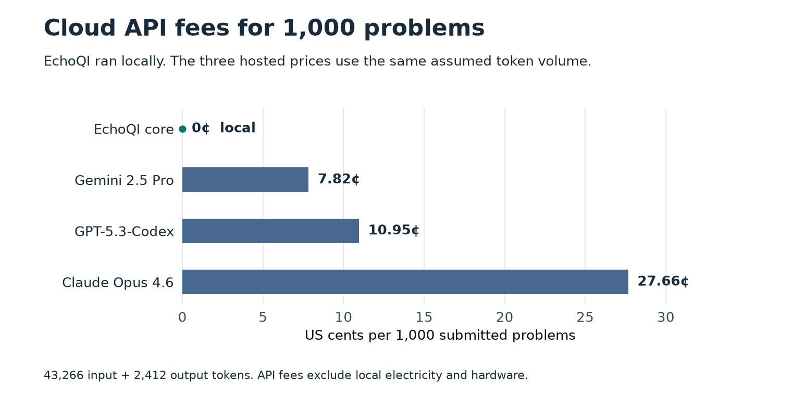
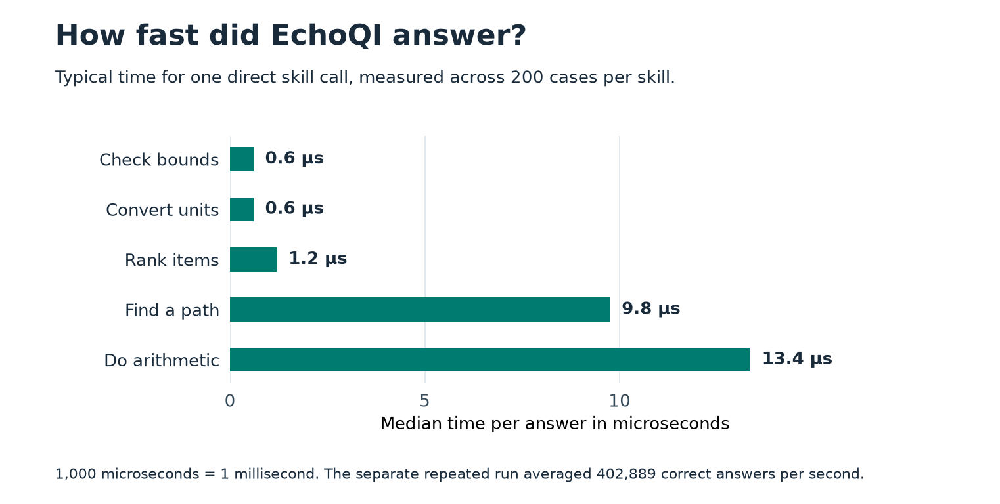

# EchoQI local symbolic skills benchmark

[Inspect the 1,000 test cases](cases.jsonl) · [CPU package measurement](cpu-package.json) · [Public checker](verify.py)

## EchoQI compared with Gemini, Codex and Claude

EchoQI completed the set locally with $0 in cloud fees. The three hosted amounts apply each provider’s standard API rates to the same example workload. Only EchoQI executed the cases in this benchmark. The chart compares fees per **submitted problem**. Accuracy and speed comparisons would require running and scoring each model on the same inputs. [Gemini pricing](https://ai.google.dev/gemini-api/docs/pricing) · [Codex pricing](https://developers.openai.com/api/docs/models/gpt-5.3-codex) · [Claude pricing](https://platform.claude.com/docs/en/about-claude/pricing)

## EchoQI’s measured speed

EchoQI returned the expected answer for all 1,000 distinct synthetic problems. A separate local run repeated the same set 5,000 times. It recorded 5,000,000 correct answers in 12.4103638 seconds, or about 402,889 correct answers per second. Both runs called the skills directly. The throughput measures these structured tasks on the test machine, rather than the time it takes to answer a chat message.

| Skill | Cases | Answer being checked |
|---|---:|---|
| Arithmetic | 200 | Integer result of a parenthesized expression |
| Unit conversion | 200 | Fahrenheit expressed in tenths of a degree from Celsius |
| Ranking | 200 | Candidate IDs in ascending or descending score order |
| Graph traversal | 200 | Whether the target is reachable from the start along the supplied edges |
| Constraint checking | 200 | Whether a value is inside the inclusive bounds |

Each line of the case file contains one input, the expected answer, the recorded answer and the skill-reported latency in milliseconds from the first run. Run **python verify.py** in this directory to check the recorded answers and recompute throughput and average power. A different solver can take just the skill and input fields and score its own answers against expected. The five-million-answer run has an aggregate receipt.

## Energy and operating cost

The CPU package energy counter recorded 0.211017 Wh across the timed run, averaging 61.21 W, or 0.0000422 Wh per thousand answers. Local execution incurred $0 in cloud API fees. To estimate the CPU electricity cost, multiply 0.000211017 kWh by the electricity rate per kWh. Whole-machine wall power and hardware costs are outside this measurement.

## Modeled API costs

The earlier comparison assumed 43,266 input tokens and 2,412 output tokens per 1,000 cases, with short answers and standard uncached rates. These are illustrative token-cost estimates. Tokenization, reasoning tokens and actual responses can change the bill.

| Model | Assumed USD per million input / output tokens | Estimated USD per 1,000 cases |
|---|---:|---:|
| Gemini 2.5 Pro | 1.25 / 10 | 0.0782 |
| GPT-5.3-Codex | 1.75 / 14 | 0.1095 |
| Claude Opus 4.6 | 5 / 25 | 0.2766 |

No competitor was timed or scored in this run. These estimates do not establish comparative speed, cost per correct answer or a usage multiplier.
