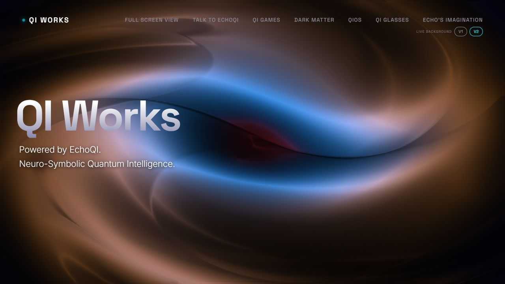

# QI Works / EchoQI.me

[Portfolio](../../../README.md) · [Evidence index](../engineering/evidence-index.md#web-application)

QI Works presents the projects. EchoQI.me connects application pages, AI integrations, user data, and games. Base44 supplies managed services; custom code handles interfaces and integrations.

## Architecture and stack

The reviewed chat entry authenticates users before forwarding requests to a shared backend. Services track sessions, usage, limits, and feature access; connection settings stay on the server.

The inspected stack includes React 18, JavaScript/TypeScript, Vite, Tailwind, React Router, TanStack Query, and Base44. Server functions use TypeScript and platform authentication/secret APIs.

## Evidence

The October 18 record contains **20 passing selected checks** across public adapters, match logic, and simulated purchase/save workflows. A separate persona log covers failures, bounded memory, session isolation, and bridge configuration. A historical Vite production build completed. These records do not verify every current signed-in workflow or live transaction.

[Selected-check receipt](../../results/2026-10-18-selected-checks.json)

## Product surface and status

*October 25, 2026 public page. Browsing was observed; chat displayed a maintenance notice.*

Current deployed features, permissions, payments, and release recovery need separate acceptance checks.

[Attributed review](../reviews/self-reports/web.md)
