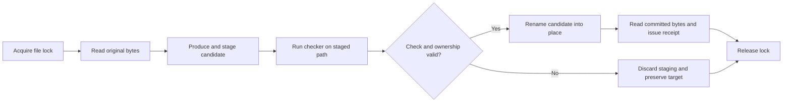

# Public engineering workflow

[Run the demonstration](README.md) · [Editing implementation](verified-edit/verified-edit.mjs) · [Evaluator](arc-harness/evaluate.mjs)

These implementations are public references written with Codex assistance. Their fixtures and algorithms are independent of the proprietary QI Core. They expose the surrounding engineering contracts so a reader can inspect, run, and modify working software.

## Editing contract

The editor owns one UTF-8 regular file. A trusted producer supplies candidate text. A trusted checker receives a staged candidate path and must settle only after its command has finished. Participating editors serialize through an exclusive lock beside the canonical target path.

| Decision | Reason and scope |
|---|---|
| Check staging before promotion | A rejected candidate or checker exception leaves the original file untouched. |
| Stage beside the source with the same extension | Module-relative imports and file-type handling remain meaningful for single-file checks. A check that requires a particular basename or a whole workspace needs an isolated workspace adapter. |
| Lock by canonical target path | Participating editors cannot both promote from a stale baseline. A busy caller can retry after the active editor finishes. |
| Recheck candidate and original bytes | Promotion requires the proposed bytes to remain checked and the target to remain at its baseline. Observed outside edits are preserved. |
| Rename rather than rewrite target content | Promotion replaces the directory entry with an already-written candidate. This is a single-file operation, not a multi-file transaction or a power-loss durability protocol. |
| Keep receipts bounded | A completion receipt identifies before/after content, the named check, and its exit status. Trust in the checker remains an explicit integration responsibility. |

The lock coordinates callers of this implementation. An outside program that ignores it can race the final comparison and rename; arbitrary concurrent filesystem writers require stronger host-level coordination. Cancellation is honored before promotion begins. I/O errors propagate to the caller. A process crash can leave staging or a lock for operator inspection; the library does not guess when another process's lock is stale.

## Evaluation contract

The scorer validates rectangular grids, withholds test answers from solver requests, clones visible data for each attempt, requires exact full-grid equality, and requires every test input in a task to pass. Its supported grid contract is 1–30 rows and columns with integer colors 0–9.

The subprocess adapter starts one executable per input with an explicit wall-time limit and a combined stdout/stderr byte limit. It uses an argument array with the shell disabled. The executable receives one JSON request on stdin and returns one JSON grid on stdout. Other output belongs on stderr within the same byte budget.

The evaluator CLI hashes the supplied task file and adapter file and emits aggregate and per-task outcomes without answers, predictions, or host paths. Adapter startup and JSON transport are included in its timing. The in-process identity baseline in the demonstration is a scoring control; its timing is not compared with subprocess timing.

A separate process provides lifecycle isolation. It retains the invoking user's filesystem and network permissions and is not a security sandbox. Evaluators control access to withheld files, network access, the core build and state, training exposure, and any descendant workers. The supplied timeout terminates the direct adapter process; an adapter that spawns workers needs evaluator-managed process-tree cleanup.

## Evidence contract

The manifest verifier checks listed relative paths within the publication root. It derives byte count and SHA-256 from the same read, validates metadata and duplicate entries, and checks resolved paths before reading. Artifact trees must remain stable during verification. Hash equality records content identity; a separate review establishes the meaning of that content.

## Validation

Automated tests exercise preservation during checker exceptions, cancellation, competing edits, staged-content changes, and simultaneous participating editors. Evaluator tests exercise sparse/malformed grids, answer withholding, mutable inputs, adapter startup, output bounds, time limits, cancellation, and CLI receipts. The demonstration connects the editor, real subprocess checks, integrity verifier, baseline, and process evaluator in one reproducible run.
