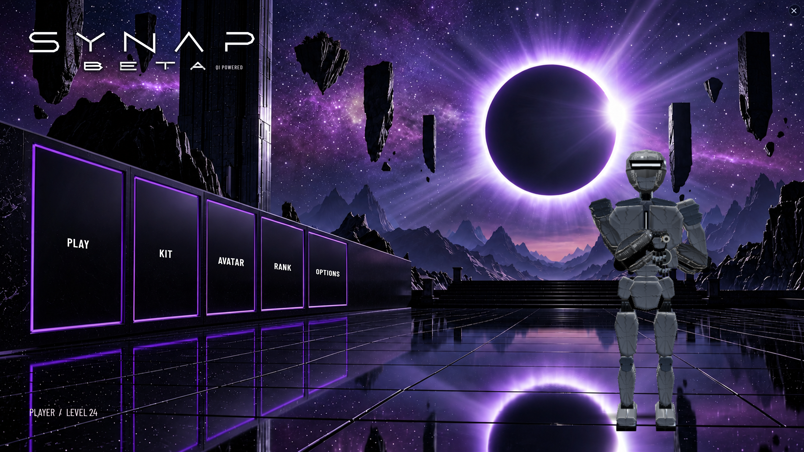

# SYNAP FPS / Dev Snap FPS

[Portfolio](../../README.md) · [Evidence index](../engineering/evidence-index.md#synap)

Jack Rourke’s science-fiction shooter: combat, enemies, equipment, progression, rendering, interfaces, and saved games. Built with AI assistance and established engines/assets; browser and native editions have separate acceptance records.

## Browser engineering

**Inspected browser build:** 0.10.222-dev.1, TypeScript, Babylon.js 9.28.0, Rapier 0.21.0, Vite, and Node checks. Source/test inventory covers combat, recoil, input, enemy tactics, progression, persistence, render batching, and effects.

## Visual presentation

**[▶ Watch SYNAP in your browser](https://jtrxgaia.github.io/Next-Gen-Intelligence/#synap)** · 2:00 · Original 1080p / 60 fps master with audio. This is the current montage featured on LinkedIn.

Earlier gameplay recording, retained for historical reference

[October 27 original recording](https://github.com/jtrxgaia/Next-Gen-Intelligence/releases/tag/synap-gameplay-demo-2026-10-27) · [Archived smaller web copy](https://github.com/jtrxgaia/Next-Gen-Intelligence/releases/download/portfolio-media-originals-2026-11-13/SYNAP-Gameplay-Demo-Web.mp4).

*Owner-supplied menu capture. The footage and image do not establish the exact engine/revision or controlled performance. Earlier gameplay screenshots remain in the media archive.*

## Performance investigation

An October 13 replay reproduced a mesh-count/milliseconds mix-up and a reporting-frequency problem. The broader frame-time regression and repeatable performance gains remain unestablished.

[Investigation](../engineering/problems-and-progress.md#synap-diagnostic-units)

## Native migration and status

**Native stack:** Unreal Engine 5.8 and C++. The October 24 `native-v129-qi-workload` record reports successful packaging, packaged combat playtests, and rollback material.

Feature parity, normal-input QA, visual acceptance, and performance acceptance remain incomplete. The record retains 21 historical suite failures; the full suite was not rerun. Sequential combat observations establish no repeatable speedup.

[Delivery receipt](../../benchmarks/results/2026-10-24-synap-native-summary.json) · [Attributed review](../reviews/self-reports/synap.md)
